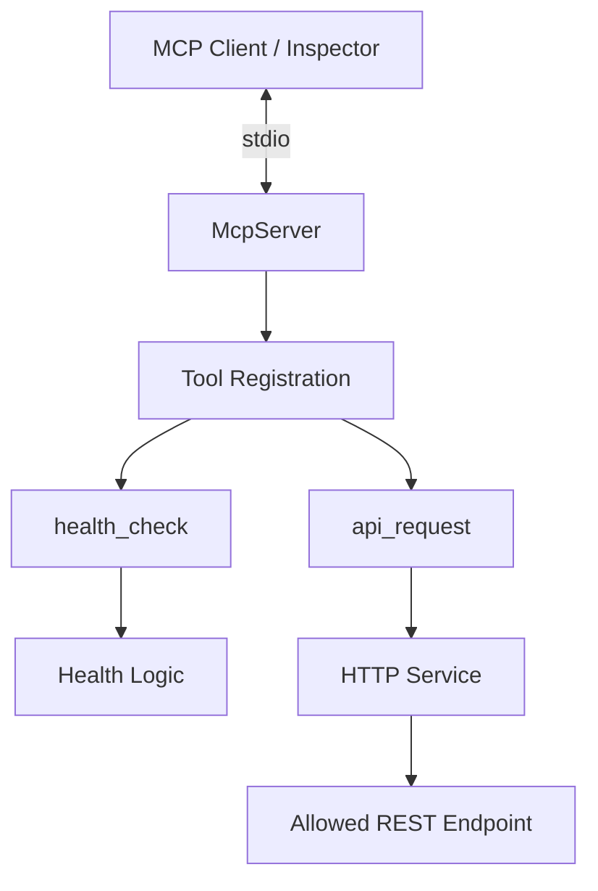

# MCPS 4 All — Project Context

> **Learn it. Build it. Break it. Improve it. Share it.**

This is the persistent engineering context for **MCPS 4 All**. Unlike the public-facing `README.md`, this file records project intent, architectural choices, constraints, learning objectives, current implementation state, and future direction. Keep it updated for material changes; **do not turn it into a commit log**.

---

## 1. Identity and purpose

- **Project:** MCPS 4 All
- **Repository:** `Hosafatto/mcps-4-all`
- **Public description:** An open-source collection of practical Model Context Protocol (MCP) servers built for learning, experimentation, automation, and real-world use.
- **Tagline:** Learn it. Build it. Break it. Improve it. Share it.
- **License:** MIT.

The long-term goal is a collection of **focused MCP servers**, not one enormous server. Start with QA/API because it is a familiar domain in which to learn the protocol, client/server interactions, schemas, error handling, and testing. Later servers may cover Playwright, databases, and other useful integrations.

The project should demonstrate genuine engineering understanding, not merely provide a résumé keyword or a collection of AI-generated snippets. The developer should be able to explain, debug, test, and extend every important component.

## 2. Learning objectives

Understand and demonstrate:

1. What MCP solves and how clients communicate with servers.
2. Server initialization, tool discovery (`tools/list`), and execution (`tools/call`).
3. Transport choices, currently stdio.
4. Tool contracts: names, descriptions, input validation, outputs, and errors.
5. Separation of MCP registration from application services.
6. Testing at unit, MCP protocol integration, and real-client levels.
7. Security tradeoffs when tools interact with external systems.
8. How to build and maintain another server independently.

Preferred loop: **choose a small capability → understand → design → implement → run → break/test → review → document → commit**.

## 3. Current technology stack

| Area | Current decision |
| --- | --- |
| Language | TypeScript, strict mode; avoid `any` as a shortcut |
| Runtime | Node.js; Node 22 in CI |
| MCP | Official TypeScript SDK, v1 dependency range |
| Transport | `StdioServerTransport` |
| Tool registration | `McpServer.registerTool()`; prefer over deprecated `tool()` |
| Validation | Zod v3 dependency range |
| HTTP | Native `fetch`, `AbortSignal.timeout()` |
| Tests | Vitest, MCP SDK `Client` + `InMemoryTransport` |
| Quality | ESLint, Prettier, TypeScript compiler |
| CI | GitHub Actions workflow configured |
| Distribution | GitHub source; npm/Docker only if justified later |

Playwright, PostgreSQL, SQL Server, Docker, and npm distribution remain **planned**, not implemented.

## 4. Current architecture

The repository currently contains **one QA/API MCP server**, not a monorepo. Avoid introducing `servers/` and shared-package abstractions until multiple independent servers justify them.

- `src/index.ts`: creates the server and connects stdio transport; startup failures go to stderr.
- `src/server.ts`: registers MCP tools and translates application results/errors to MCP responses.
- `src/tools/health/`: pure health-check logic.
- `src/tools/api/`: validates the allowed HTTP destination and invokes the HTTP service.
- `src/services/http/`: executes GET via native `fetch`, applies timeout, rejects redirects, parses JSON when possible, and preserves text otherwise.
- `src/schemas/api-request.ts`: Zod input contract for `api_request`.
- `tests/`: unit and in-memory MCP integration tests.

Keep protocol-specific registration thin; business logic should be independently testable. Do not create premature abstractions.

## 5. Implemented MCP tools

### `health_check` — implemented

- No input parameters.
- Returns a text content item with JSON `{ "status": "ok", "timestamp": "<ISO-8601 UTC>" }`.
- Confirms basic server responsiveness, not the health of external infrastructure.
- Successfully discovered and executed from MCP Inspector.
- Covered by unit and MCP protocol integration tests.

### `api_request` — implemented, deliberately restricted

- Method: **GET only**.
- Inputs: `url` (valid HTTPS URL) and optional `timeoutMs` (integer 1000–10000, default 5000).
- Allowed destination: exactly `jsonplaceholder.typicode.com` over default HTTPS port; no automatic redirects.
- Returns MCP text content containing JSON with `status`, `ok`, `url`, and `body`.
- JSON response bodies are parsed; other bodies remain text.
- HTTP 4xx/5xx statuses return structured results with `ok: false` rather than automatically throwing.
- Invalid arguments are rejected by Zod at the MCP boundary; blocked destinations and request execution failures are represented as MCP tool errors.
- Verified manually with MCP Inspector using successful GET, HTTP 404, disallowed hostname, and invalid timeout inputs.
- Covered by unit tests and MCP protocol integration tests.

**Not supported yet:** POST/PUT/PATCH/DELETE, custom headers, authentication, request bodies, arbitrary hosts, streaming, response-size caps, or generalized URL policies. Do not describe the tool as a production-safe general HTTP proxy.

## 6. Verification and testing

Latest user-confirmed local results:

- **12/12 Vitest tests passed**, across 3 files.
- `npm run lint` passed.
- `npm run build` passed.
- Both tools were discovered in MCP Inspector using stdio.
- `api_request` successfully retrieved data from the public JSONPlaceholder API.

Test distribution:

| File | Tests | Purpose |
| --- | ---: | --- |
| `tests/server.test.ts` | 1 | Health-check logic |
| `tests/api-request.test.ts` | 6 | HTTP/API behavior, including abort signal |
| `tests/mcp-integration.test.ts` | 5 | Tool discovery, execution, Zod validation, MCP errors |

`InMemoryTransport` connects an official MCP client and server inside Vitest; the external `fetch` call is mocked. Integration tests verify the MCP protocol path without network dependencies.

**Important limitations:** The timeout test uses a mocked fetch that honors the abort signal, not a real network stall. The unit test that mocks a fetch error message does not itself prove network timeout behavior. No claim of comprehensive SSRF protection or CI pass should be made without independent verification.

## 7. Security decisions and risks

Current safeguards for `api_request`:

- Zod validates the URL and timeout input.
- The API tool restricts scheme, hostname, and port.
- The HTTP service rejects redirects (`redirect: 'error'`).
- Requests have a bounded timeout.

These are **initial demonstration constraints**, not a complete SSRF defense. Future generalized HTTP tooling must consider DNS resolution, private/reserved IP blocking, DNS rebinding, redirects, proxy behavior, response-size limits, credential exposure, and network boundaries. Avoid broad network or filesystem access for convenience.

Never commit secrets. Use `.env.example` for safe configuration examples. Keep MCP stdout clean; diagnostics belong on stderr.

## 8. v0.1 scope and remaining work

| Capability | State |
| --- | --- |
| TypeScript MCP server and stdio transport | Done |
| `health_check` | Done |
| `api_request` restricted GET | Done |
| Zod validation and basic error handling | Done for implemented tools |
| Unit and MCP integration tests | Done for implemented tools |
| Manual MCP Inspector verification | Done for implemented tools |
| `validate_status_code` | Planned |
| `validate_json_property` | Planned |
| Full v0.1 documentation/review/merge | Pending completion |

`package.json` currently declares version `0.1.0`, but the **v0.1 milestone is not complete or stable**.

### Immediate next milestone

1. Review the current changes, documentation, and GitHub Actions results; create/merge a PR after review.
2. Implement `validate_status_code` with an explicit expected-vs-actual contract and clear pass/fail output.
3. Implement `validate_json_property` with a deliberately small, documented JSON property/value contract.
4. Add appropriate unit, MCP integration, and real-client tests for both tools.
5. Revisit API security and output limits before expanding allowed destinations or methods.

## 9. Roadmap

| Phase | Focus |
| --- | --- |
| v0.1 | MCP fundamentals and initial QA/API tools |
| v0.2 | Extended API validation and tool contracts |
| v0.3 | Playwright integration |
| v0.4 | PostgreSQL/SQL Server data tools |
| v0.5 | Test generation |
| v0.6 | Reporting and failure analysis |
| v1.0 | Stable toolkit and distribution |

These are directions, not delivery promises. Only mention a technology as implemented once the repository actually uses it.

Potential future QA work: headers/auth, richer HTTP methods, JSON path and JSON Schema validation, OpenAPI contracts, response-time assertions, test chaining, and better error reporting. Database tools should start read-only with least-privilege access. Playwright tools should have controlled scope and reviewable artifacts. AI-generated tests require human review.

## 10. Engineering rules

- Prefer small, focused tools with clear descriptions, inputs, outputs, and error semantics.
- Keep TypeScript strict; use runtime validation when crossing trust boundaries.
- Keep MCP registration separate from domain services.
- Prefer deterministic tests; mock external HTTP in automated tests.
- Test meaningful failures, not only happy paths.
- Do not weaken valid contracts to accommodate incomplete mocks.
- Avoid premature monorepo or framework abstractions.
- Be accurate about what is implemented, planned, tested, and released.
- Use the official SDK APIs supported by the installed version.

### Definition of Done

A feature is done when it is implemented, works locally, has appropriate passing tests, is documented, has been verified from a real MCP client when relevant, has undergone design/security review, and has been merged. A passing unit test alone is insufficient.

## 11. Portfolio success criteria

The developer should be able to clone and run the project, explain the protocol and transport, trace a tool call, explain the schemas, debug failures, modify tests, articulate security boundaries, and build another MCP server without a tutorial. The repository should provide verifiable evidence of those skills.

## 12. Repository metadata

Initial GitHub topics: `mcp`, `model-context-protocol`, `mcp-server`, `typescript`, `nodejs`, `ai-tools`, `developer-tools`, `open-source`.

Now that restricted QA/API functionality exists, appropriate additional topics include `software-testing`, `qa-automation`, `api-testing`, and `sdet`. Add `playwright` only after an actual Playwright integration exists.

## 13. Context maintenance rule

Update this file when decisions materially change architecture, stack, scope, roadmap, tool contracts, repository structure, security boundaries, Definition of Done, learning objectives, or distribution strategy. Preserve the reasons behind important choices. Keep `README.md` synchronized with public-facing behavior, but **do not use this file as a changelog**; Git already records individual changes.
