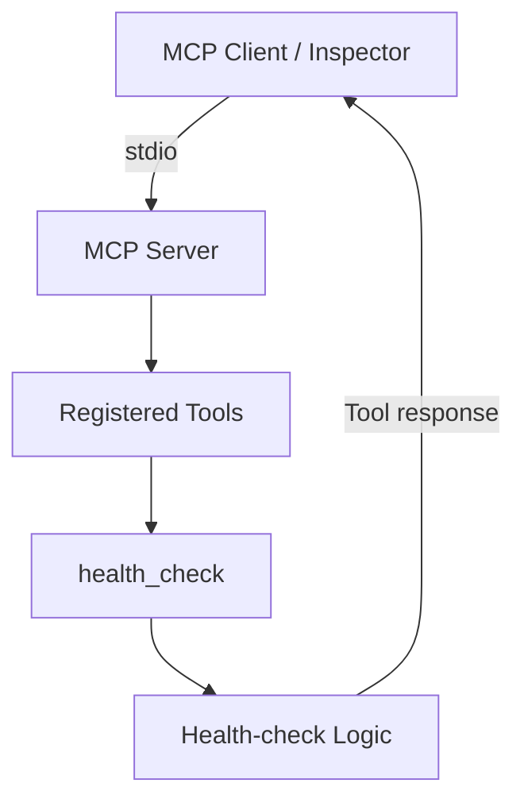

# MCPS 4 All

> **Learn it. Build it. Break it. Improve it. Share it.**

**MCPS 4 All** is an open-source project for learning, building, testing, and sharing practical [Model Context Protocol (MCP)](https://modelcontextprotocol.io/) servers.

The project starts with a focused QA/API server and will grow incrementally as new capabilities are implemented and verified.

## Current Status

**Early development — first MCP tool operational.**

The project has a working TypeScript MCP server using the **stdio** transport. Its first tool, `health_check`, has been discovered and executed successfully using **MCP Inspector**.

| Capability | Status |
| --- | --- |
| MCP server with stdio transport | Implemented |
| `health_check` | Implemented and verified in MCP Inspector |
| TypeScript build | Verified locally |
| Unit test for health-check logic | Passing locally |
| ESLint | Passing locally |
| `api_request` | Planned |
| `validate_status_code` | Planned |
| `validate_json_property` | Planned |
| Playwright and database integrations | Future milestones |

> **Version note:** `package.json` currently declares `0.1.0`, but the full v0.1.0 feature scope is **not complete**. This is an early implementation, not a stable release.

## Why This Project?

MCP allows applications and AI clients to discover and invoke tools through a standard protocol. MCPS 4 All explores that model through small, understandable, independently testable tools.

Our principles:

- Learn the protocol rather than blindly generate code.
- Keep each tool focused and clearly documented.
- Separate MCP registration and transport from application logic.
- Validate inputs and handle errors deliberately.
- Test functionality through a real MCP client.
- Distinguish implemented functionality from roadmap ideas.

## Technology Stack

- **Language:** TypeScript (strict mode)
- **Runtime:** Node.js 22 (used in CI)
- **MCP:** Official `@modelcontextprotocol/sdk` (v1 dependency range)
- **Validation:** Zod
- **Package manager:** npm
- **Testing:** Vitest
- **Code quality:** ESLint and Prettier
- **CI:** GitHub Actions

Native `fetch` is planned for API tools. Playwright, databases, and Docker are not part of the current working implementation.

## Getting Started

### Prerequisites

- Node.js 22
- npm

### Installation

```bash
git clone https://github.com/Hosafatto/mcps-4-all.git
cd mcps-4-all
npm ci
```

### Build

```bash
npm run build
```

This compiles the TypeScript source to `dist/`.

### Run Checks

```bash
npm run lint
npm test
npm run build
```

The existing unit test verifies the health-check logic. A successful unit test does **not** by itself verify the MCP transport or tool registration; use MCP Inspector for that.

## Run With MCP Inspector

[MCP Inspector](https://github.com/modelcontextprotocol/inspector) is a development client for exploring and calling MCP tools.

First, build the project:

```bash
npm run build
```

Then launch Inspector from the repository root:

```bash
npx @modelcontextprotocol/inspector node dist/index.js
```

Open the **Inspector URL printed in the terminal**. If it includes an authentication token, keep that token private.

In Inspector:

1. Select **STDIO** as the transport.
2. Set **Command** to `node`.
3. Set **Arguments** to `dist/index.js`.
4. Click **Connect**.
5. Open **Tools** and click **List Tools**.
6. Select **`health_check`** and click **Run Tool**.

Expected tool response (timestamp varies):

```json
{
  "status": "ok",
  "timestamp": "2026-10-28T21:26:20.224Z"
}
```

**Important:** This server uses stdio, not an HTTP listening port. Do not expect a web page or a service on port 3000.

Standard output is reserved for MCP protocol messages; send diagnostic messages to standard error.

## Available Tools

### `health_check`

Returns the server's basic operational status and a UTC ISO 8601 timestamp.

- **Input:** None
- **Output:** A text content item containing JSON with `status` and `timestamp`
- **Side effects:** None

Example JSON payload:

```json
{
  "status": "ok",
  "timestamp": "2026-10-28T21:26:20.224Z"
}
```

This confirms that the tool is callable; it is **not** a comprehensive dependency or infrastructure health check.

## Architecture



The code is organized so domain logic can be tested separately from the MCP interface.

## Repository Structure

```text
mcps-4-all/
├── .github/
│   ├── copilot-instructions.md
│   └── workflows/
│       └── ci.yml
├── Contexto.MD
├── Documentacion/
├── docs/
├── examples/
├── src/
│   ├── index.ts
│   ├── server.ts
│   ├── tools/
│   │   ├── health/
│   │   └── api/
│   ├── services/
│   ├── schemas/
│   └── utils/
├── tests/
├── .env.example
├── .gitignore
├── LICENSE
├── package.json
├── package-lock.json
├── README.md
├── tsconfig.json
└── vitest.config.ts
```

Some folders are scaffolding for future work and do not yet provide operational features.

## Roadmap

| Milestone | Focus |
| --- | --- |
| **v0.1** | MCP fundamentals and QA/API tools |
| **v0.2** | Extended API validation |
| **v0.3** | Playwright integration |
| **v0.4** | Database tools |
| **v0.5** | Test generation |
| **v0.6** | Reporting and failure analysis |
| **v1.0** | Stable, documented toolkit |

Planned initial QA/API tools:

- `api_request`
- `validate_status_code`
- `validate_json_property`

These tools are **not yet available**.

Roadmap priorities and versions may change as the project evolves.

## Security

The current `health_check` tool has no inputs or external side effects.

Future HTTP, database, and browser tools will require explicit security boundaries, including:

- URL validation and restrictions
- Protection against SSRF
- Safe handling of credentials
- Request timeouts
- Response-size limits
- Appropriately limited permissions
- Clear separation of read-only and write operations

Never commit real secrets or credentials. Use `.env.example` for placeholders.

## Development Workflow

A feature is considered done only after it is implemented, tested, documented, and—when applicable—verified through a real MCP client.

Project decisions and the current implementation state are maintained in [`Contexto.MD`](Contexto.MD).

GitHub Copilot project guidance lives in [`.github/copilot-instructions.md`](.github/copilot-instructions.md).

## License

Licensed under the [MIT License](LICENSE).
