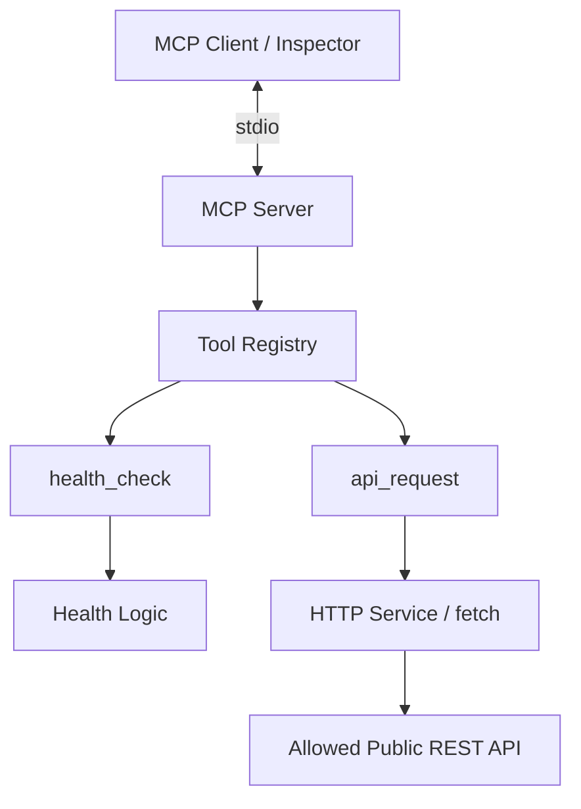

# MCPS 4 All

> **Learn it. Build it. Break it. Improve it. Share it.**

**MCPS 4 All** is an open-source collection of practical [Model Context Protocol (MCP)](https://modelcontextprotocol.io/) servers built for learning, experimentation, QA automation, and real-world use.

The first implementation is a TypeScript QA/API MCP server. It demonstrates real tool discovery and execution through the MCP protocol, with independently testable application logic.

## Current status

**Early development — two working MCP tools.** The server uses the official MCP TypeScript SDK and the `stdio` transport. Both tools have been exercised through MCP Inspector; the project also has automated unit and in-memory MCP integration tests.

| Capability | Status |
| --- | --- |
| MCP server over stdio | Implemented; verified with MCP Inspector |
| `health_check` | Implemented; manually and automatically tested |
| `api_request` (GET) | Implemented; manually and automatically tested |
| Zod input validation | Implemented for `api_request` |
| HTTPS and fixed-host restrictions | Implemented for current API demo |
| Request timeout and redirect rejection | Implemented; timeout behavior tested with a mock |
| Vitest | 12 tests passing locally (6 API + 5 MCP integration + 1 health) |
| ESLint / TypeScript build | Passing locally |
| `validate_status_code` | Planned |
| `validate_json_property` | Planned |
| Playwright and database integrations | Future milestones |

> **Version note:** `package.json` declares `0.1.0`, but the complete v0.1 scope is **not finished**. This is not a stable release.

## Why this project?

MCP enables clients and AI applications to discover and call tools through a standard protocol. This repository explores that model with small, focused tools, explicit contracts, practical tests, and honest documentation.

Our principles:

- Understand the protocol instead of blindly copying generated code.
- Keep MCP registration separate from application logic.
- Validate inputs and handle failures deliberately.
- Verify tools with both automated tests and a real MCP client.
- Build incrementally; distinguish implemented features from roadmap ideas.

## Technology stack

- **Language:** TypeScript, strict mode
- **Runtime:** Node.js 22 (CI target)
- **MCP:** Official `@modelcontextprotocol/sdk` v1 dependency range
- **Validation:** Zod v3 dependency range
- **HTTP:** Native Fetch API
- **Package manager:** npm
- **Testing:** Vitest; MCP SDK `Client` and `InMemoryTransport`
- **Code quality:** ESLint and Prettier
- **CI configuration:** GitHub Actions

Playwright, databases, Docker, and package distribution are not implemented yet.

## Getting started

### Prerequisites

- Node.js 22
- npm

### Install and build

```bash
git clone https://github.com/Hosafatto/mcps-4-all.git
cd mcps-4-all
npm ci
npm run build
```

TypeScript is compiled into `dist/`.

### Run quality checks

```bash
npm test
npm run lint
npm run build
```

The latest local verification passed **12 tests across 3 test files**, including 5 in-memory MCP protocol integration tests. The integration tests mock external HTTP calls; they do not require network access.

## Run with MCP Inspector

[MCP Inspector](https://github.com/modelcontextprotocol/inspector) lets you discover and execute tools from an MCP client.

```bash
npm run build
npx @modelcontextprotocol/inspector node dist/index.js
```

Open the full URL printed by Inspector in your terminal. Treat any proxy session token in that URL as a secret.

In Inspector:

1. Select **STDIO**.
2. Set **Command** to `node` and **Arguments** to `dist/index.js`.
3. Click **Connect**.
4. Open **Tools** and select **List Tools**.
5. Run `health_check` or `api_request`.

**Note:** This server communicates over standard input/output; it does not listen on HTTP port 3000. Keep stdout reserved for MCP messages and use stderr for diagnostics. After changing TypeScript code, rebuild before restarting Inspector.

## Available tools

### `health_check`

Checks basic MCP server responsiveness.

**Input:** none. **Side effects:** none.

Example text-content JSON:

```json
{
  "status": "ok",
  "timestamp": "2026-11-06T20:00:00.000Z"
}
```

The timestamp is illustrative and is generated at execution time. This is not a comprehensive infrastructure health check.

### `api_request`

Makes a controlled **HTTP GET** request and returns the status, success flag, final URL, and parsed response body.

**Inputs:**

| Field | Type | Rules |
| --- | --- | --- |
| `url` | string | Valid HTTPS URL; current implementation permits only `jsonplaceholder.typicode.com` on the default HTTPS port |
| `timeoutMs` | integer, optional | 1000–10000 ms; default 5000 ms |

**Example input in MCP Inspector:**

```json
{
  "url": "https://jsonplaceholder.typicode.com/todos/1",
  "timeoutMs": 5000
}
```

**Example response payload:**

```json
{
  "status": 200,
  "ok": true,
  "url": "https://jsonplaceholder.typicode.com/todos/1",
  "body": {
    "userId": 1,
    "id": 1,
    "title": "delectus aut autem",
    "completed": false
  }
}
```

JSON responses are parsed; non-JSON bodies remain strings. HTTP error statuses such as `404` return `ok: false` rather than automatically throwing. Invalid tool inputs are rejected by Zod; disallowed hosts and request failures produce MCP tool errors.

**Current limitations:** GET only; no custom headers, authentication, request bodies, or arbitrary hosts. Automatic redirects are rejected. This is a deliberately restricted demonstration tool, not a general-purpose HTTP proxy.

## Testing strategy

| Test layer | What it verifies |
| --- | --- |
| Unit: health | Basic status and timestamp |
| Unit: HTTP/API | GET results, 404, blocked host, execution errors, text response, abort signal |
| MCP integration | `tools/list`, `tools/call`, Zod rejection, blocked-host errors |
| Manual MCP Inspector | Real stdio client connection and tool execution against the public test API |

The timeout test uses a mocked `fetch` that honors `AbortSignal`; it is **not** a live network timeout test. External HTTP is mocked in automated tests to keep them deterministic.

## Architecture



Tool registration lives in `src/server.ts`; application behavior is kept in `src/tools/` and `src/services/` for independent testing.

## Repository structure

```text
mcps-4-all/
├── .github/
│   ├── copilot-instructions.md
│   └── workflows/
├── Contexto.MD
├── Documentacion/
├── docs/
├── examples/
├── src/
│   ├── index.ts
│   ├── server.ts
│   ├── schemas/api-request.ts
│   ├── tools/{health,api}/
│   └── services/http/
├── tests/
│   ├── server.test.ts
│   ├── api-request.test.ts
│   └── mcp-integration.test.ts
├── .env.example
├── .gitignore
├── LICENSE
├── package.json
├── package-lock.json
└── tsconfig.json
```

Some folders are placeholders for later features.

## Roadmap

| Milestone | Focus |
| --- | --- |
| **v0.1** | MCP fundamentals; `health_check` and `api_request` done; status/JSON validation tools pending |
| **v0.2** | Extended API validation |
| **v0.3** | Playwright integration |
| **v0.4** | Database tools |
| **v0.5** | Test generation |
| **v0.6** | Reporting and failure analysis |
| **v1.0** | Stable toolkit and distribution |

The roadmap is directional and may evolve.

## Security

The current `api_request` tool validates HTTPS, allows one explicit test hostname, rejects nondefault ports and redirects, and limits request duration. **These measures are not a complete SSRF defense.** Broader network access would require DNS/IP-level protections, response-size limits, and a reviewed threat model. Do not expose unrestricted HTTP access without those safeguards.

Never commit credentials. Use `.env.example` for configuration placeholders.

## Development workflow

A feature is done when its behavior is implemented, tested, documented, verified with a real MCP client where applicable, reviewed, and merged. Decisions and current state are maintained in [`Contexto.MD`](Contexto.MD); Copilot guidance lives in [`.github/copilot-instructions.md`](.github/copilot-instructions.md).

## License

Licensed under the [MIT License](LICENSE).